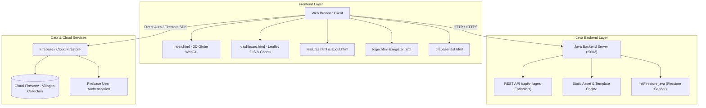

<div align="center">

  # 🌾 SmartGram
  ### Digital Twin Platform for Rural Village Development & AI Resource Forecasting

  [](https://openjdk.org/)
  [](https://spring.io/projects/spring-boot)
  [](https://developer.mozilla.org/en-US/docs/Web/HTML)
  [](https://developer.mozilla.org/en-US/docs/Web/CSS)
  [](https://developer.mozilla.org/en-US/docs/Web/JavaScript)
  [](https://threejs.org/)
  [](https://leafletjs.com/)
  [](https://firebase.google.com/)
  [](https://learn.microsoft.com/powershell/)
  [](LICENSE)

  <p align="center">
    <b>Empowering rural development through interactive 3D spatial mapping, real-time GIS visualization, and multi-decade AI population and resource demand projection. Built with Java (JDK 21 LTS & Spring Boot 3), HTML5, CSS3, JavaScript, Leaflet GIS, and Three.js.</b>
  </p>

  [Features](#-key-features) •
  [Architecture](#-system-architecture) •
  [Quick Start](#-quick-start-guide) •
  [Firebase Setup](#-firebase-integration-setup) •
  [API Reference](#-api-reference) •
  [AI Models](#-ai--predictive-modeling)

---

</div>

## 📖 Overview

**SmartGram** is an end-to-end web platform designed to bridge the data gap in rural infrastructure planning. By combining **3D Digital Twin visualization**, **Geographic Information Systems (GIS)**, and **Predictive Artificial Intelligence**, SmartGram allows urban planners, government officials, and NGOs to analyze current village statistics and forecast future infrastructure demands up to 100 years into the future.

```
                  ┌─────────────────────────────────────────┐
                  │          SmartGram Platform             │
                  └────────────────────┬────────────────────┘
                                       │
         ┌─────────────────────────────┼─────────────────────────────┐
         ▼                             ▼                             ▼
┌───────────────────┐        ┌───────────────────┐        ┌───────────────────┐
│  3D Digital Twin  │        │  GIS Interactive  │        │   AI Predictive   │
│ WebGL Rotating    │        │    Map & Local    │        │ Population & Water│
│ Spatial Interface │        │   Infrastructure  │        │ Demand Forecasts  │
└───────────────────┘        └───────────────────┘        └───────────────────┘
```

---

## ✨ Key Features

### 🌐 1. Interactive 3D WebGL Globe & Modern UI
- **Real-Time 3D Rendering**: Built with **Three.js** featuring photorealistic Earth texture mapping, dynamic ambient lighting, and interactive spatial rotation.
- **Unified Navigation & Authentication**: Glassmorphism navbar with sticky navigation, active link tracking, and integrated **Firebase Authentication** account dropdowns.

### 🗺️ 2. GIS Digital Twin Mapping
- **Geographic Precision**: Powered by **Leaflet.js** and OpenStreetMap tiles.
- **Dynamic Centering & Markers**: Automatically centers on selected villages (e.g., *Nagazari, Ahmednagar, Manjara, Phaltan, Indapur*) with custom map popups displaying village names and coordinates.

### 📊 3. Analytics & Infrastructure Dashboards
- **Multi-Metric Overview Panels**: Real-time display of population count, total land area, housing units, primary agricultural crops, and income sources.
- **Infrastructure Tracking**: Monitor community halls, healthcare centers, financial institutions, power supply hours (agricultural vs. domestic), and water tanks.
- **Interactive Charting (Chart.js)**: Doughnut chart breakdown of water sources (*Borewells, Open Wells, Lakes, Private Connections*).

### 🤖 4. AI-Powered Resource Forecasting
- **Dynamic Growth Projection**: Forecast population growth across **10, 30, 50, and 100-year horizons**.
- **Water Demand Estimation**: Line chart projection of daily water consumption requirements (liters/day) computed dynamically based on demographic growth curves.

### ☕ 5. Pure Java High-Performance Backend & Cloud Persistence
- **Java 21 Virtual Threads**: Built with modern Java 21 concurrency (Project Loom) delivering ultra-lightweight, high-throughput REST APIs.
- **Enterprise Spring Boot 3**: Fully modular Spring Web MVC architecture with POJO models and repository pattern.
- **Firebase Cloud Firestore**: Cloud synchronization with authentication-aware data fetching.
- **In-Memory REST API Fallback**: Offline mode fallback to local in-memory village structures ensuring zero downtime during network outages or key misconfigurations.

---

## 🏗️ System Architecture



---

## 📁 Project Structure

```
SmartGram/
├── run-java.bat                # 1-Click launcher for Java Backend (Windows)
├── run-java.ps1                # PowerShell launcher for Java Backend
├── FIREBASE_SETUP_GUIDE.md     # Dedicated guide for Firebase service account setup
├── .gitignore                  # Git exclusion rules for builds & credentials
├── README.md                   # Project documentation
├── backend/                    # ☕ Java Backend (JDK 21 & Spring Boot 3)
│   ├── SmartGramServer.java    # Standalone Virtual-Threaded Java HTTP Server
│   ├── InitFirestore.java      # Firestore automated dataset seeding in Java
│   ├── README.md               # Dedicated Java backend documentation
│   └── spring-boot/            # Enterprise Spring Boot 3 MVC Project
│       ├── pom.xml             # Maven dependencies
│       └── src/main/java/com/smartgram/
│           ├── SmartGramApplication.java
│           ├── model/Village.java
│           ├── repository/VillageRepository.java
│           ├── controller/VillageApiController.java
│           ├── controller/WebViewController.java
│           └── config/WebMvcConfig.java
└── frontend/
    ├── static/
    │   ├── css/
    │   │   └── style.css       # Unified design system & responsive layout CSS
    │   ├── images/
    │   │   ├── logo.png        # Brand logo asset
    │   │   └── LogoAbout.png   # About page graphic asset
    │   └── js/
    │       ├── firebase-config.js # Firebase initialization & credentials
    │       ├── map.js          # GIS Leaflet mapping helper scripts
    │       ├── charts.js       # Chart.js visualization wrappers
    │       └── main.js         # Core UI event handlers & utility routines
    └── templates/
        ├── index.html          # Homepage with 3D WebGL globe
        ├── dashboard.html      # Main Digital Twin dashboard & AI charts
        ├── features.html       # Platform capability showcase
        ├── about.html          # Mission & technology overview
        ├── login.html          # Firebase login portal
        ├── register.html       # Firebase user registration portal
        ├── admin_dashboard.html# Data management console
        ├── village_detail.html # Comprehensive single-village deep dive
        └── firebase-test.html  # Diagnostic test suite for Firebase connection
```

---

## 🚀 Quick Start Guide

### Prerequisites
- **Java**: JDK 21 or higher
- **Web Browser**: Chrome, Firefox, Edge, or Safari with WebGL enabled

---

### Method 1: Instant Standalone Java Server (Zero External Setup)

You can launch the complete SmartGram backend instantly with Java 21 without installing Maven or third-party packages:

```powershell
# Using the Windows Launchers:
.\run-java.ps1
# or double-click run-java.bat

# Or compile and run directly via Java CLI:
javac -d backend/bin backend/SmartGramServer.java
java -cp backend/bin com.smartgram.SmartGramServer 5002
```

---

### Method 2: Enterprise Spring Boot 3

```bash
cd backend/spring-boot
mvn spring-boot:run
```

---

### 🌐 Open in Your Browser
Once the server is running on port 5002:
- **Homepage (3D Globe):** `http://localhost:5002`
- **Dashboard (GIS & AI):** `http://localhost:5002/dashboard`
- **REST API:** `http://localhost:5002/api/villages`

---

## ☁️ Firebase Integration Setup

SmartGram integrates seamlessly with **Google Firebase** for authentication and cloud database synchronization.

### Step 1: Obtain Service Account Key
1. Go to the [Firebase Console](https://console.firebase.google.com/) and select your project (`smart-gram-95a83`).
2. Go to **Project Settings** ⚙️ ➔ **Service Accounts**.
3. Click **Generate New Private Key** and download the JSON file.
4. Rename and place the key at: `backend/serviceAccountKey.json` *(Note: This file is automatically ignored by `.gitignore` for security)*.

### Step 2: Seed the Cloud Firestore Database
Populate Firestore with initial village datasets using Java:
```bash
cd backend
java -cp "bin;lib/*" com.smartgram.InitFirestore
```

### Step 3: Run Connection Diagnostics
Open `http://localhost:5002/firebase-test.html` in your browser to run automated connection diagnostics on:
- Firebase Module Resolution
- Service Configuration Validity
- Firestore Connectivity & Village Document Fetching
- Network Reachability

For complete details, see [FIREBASE_SETUP_GUIDE.md](FIREBASE_SETUP_GUIDE.md).

---

## 🔌 API Reference

SmartGram provides a clean Flask REST API for village metadata and metrics.

### Endpoints

| Method | Endpoint | Description |
| :--- | :--- | :--- |
| `GET` | `/` | Renders the 3D WebGL Homepage (`index.html`) |
| `GET` | `/dashboard` | Renders the Digital Twin Dashboard (`dashboard.html`) |
| `GET` | `/api/villages` | Returns list of all available villages |
| `GET` | `/api/villages/<id>` | Returns full details & metrics for a specific village ID |
| `GET` | `/login` | Renders Login interface |
| `GET` | `/signup` | Renders Registration interface |
| `GET` | `/<page>.html` | Dynamic HTML template rendering route |

### Sample API Response (`GET /api/villages/nagazari`)

```json
{
  "name": "Nagazari",
  "population": 8500,
  "totalArea": "28800 sq meter",
  "houses": 1200,
  "mainCrops": ["Sugarcane", "Cotton", "Jowar"],
  "IncomesSources": ["Agriculture", "Sugar Mill", "Dairy"],
  "communityHall": 1,
  "healthFacility": 1,
  "bank": 1,
  "WaterSupply": {
    "boreWell": 45,
    "well": 12,
    "lake": 1,
    "own": 2
  },
  "Power Supply": {
    "agricultural": "8 hours",
    "domestic": "24 hours"
  },
  "Tanks": ["Navapur Tank", "Mutha Tank"],
  "location": "[21.08266, 78.60331]"
}
```

---

## 🤖 AI & Predictive Modeling

SmartGram utilizes mathematical modeling to project long-term demographic and resource shifts:

### Population Growth Model
```
P(t) = P₀ × (1 + r)^t
```
Where:
- $P_0$ = Base population of target village
- $r$ = Compound annual growth rate ($1.5\%$ baseline)
- $t$ = Forecast horizon ($10, 30, 50,$ or $100$ years)

### Projected Water Demand Model
```
W(t) = P(t) × 135  (Liters per Day)
```
*Based on standard per capita daily water allocation standards (135 L/person/day).*

---

## 💻 Tech Stack

- **Frontend Core**: HTML5, CSS3 (Custom Glassmorphic Variables & Responsive Grid), Vanilla ES6 JavaScript
- **3D Visualization**: [Three.js](https://threejs.org/) (WebGL rendering engine)
- **Mapping GIS**: [Leaflet.js](https://leafletjs.com/) v1.9.4 & OpenStreetMap
- **Data Charting**: [Chart.js](https://chartjs.org/)
- **Java Backend**: [Java 21 LTS](https://openjdk.org/) (Virtual Threads), [Spring Boot 3.2](https://spring.io/projects/spring-boot) / Standalone HTTP Server
- **Cloud Database & Auth**: Google [Firebase Admin SDK](https://firebase.google.com/docs/admin/setup) & Cloud Firestore

---

## 🤝 Contributing

Contributions, issues, and feature requests are welcome!
1. Fork the Project (`https://github.com/harshdewase51-collab/Smart-Gram.git`)
2. Create your Feature Branch (`git checkout -b feature/AmazingFeature`)
3. Commit your Changes (`git commit -m 'Add some AmazingFeature'`)
4. Push to the Branch (`git push origin feature/AmazingFeature`)
5. Open a Pull Request

---

## 📄 License

Distributed under the MIT License. See `LICENSE` for more information.

---

<div align="center">
  <b>Built with ❤️ for rural development and sustainable community growth</b>
</div>
